# zone-knowledge-buddy · 知识伙伴

基于大模型 Agent 的多格式个人知识管理系统（毕业设计项目）。导入 PDF / Word / Markdown / Excel / 网页，自动解析分块向量化，通过 Agent 生成带**可回溯引用**的笔记与自包含 HTML 报告，并提供 RAG 流式知识问答。

技术栈：FastAPI + SQLAlchemy(SQLite) + ChromaDB（后端）· Vue 3 + Vite + Element Plus + Pinia（前端）。

## 页面预览

> 以下为本地真实运行截图（视口 1440×900），原图位于 `docs/screenshots/`。

| 登录 · 默认账号 `admin / admin123` | 工作台 · 「知识库 → 问答 → 产出」三步导览，拖拽上传 / 网页导入，最近产出 |
|:--:|:--:|
| 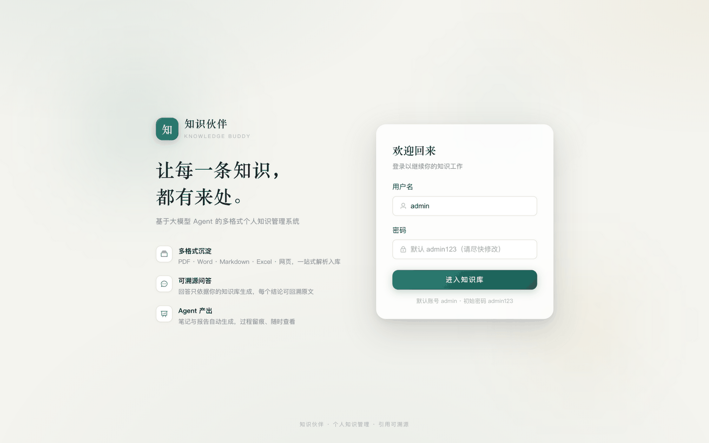 | 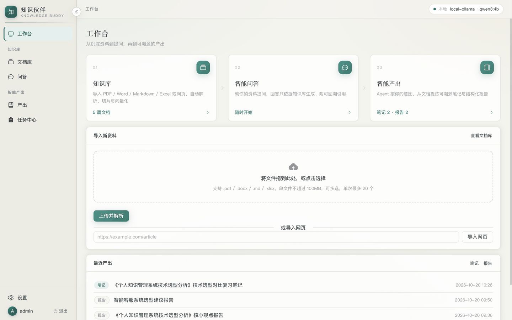 |

| 文档库 · 按来源类型筛选，卡片 / 列表视图，解析状态与块数 | 文档详情 · 解析后的分块正文，表格独立成块 |
|:--:|:--:|
| 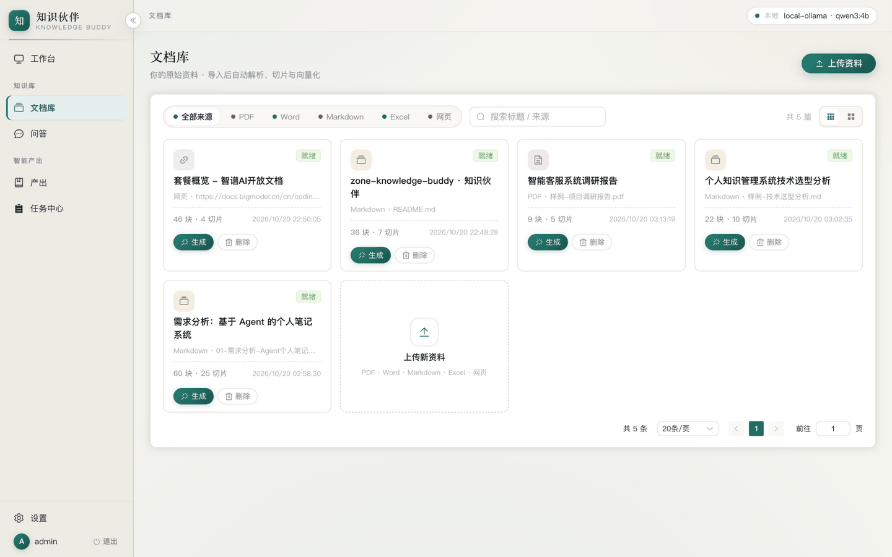 | 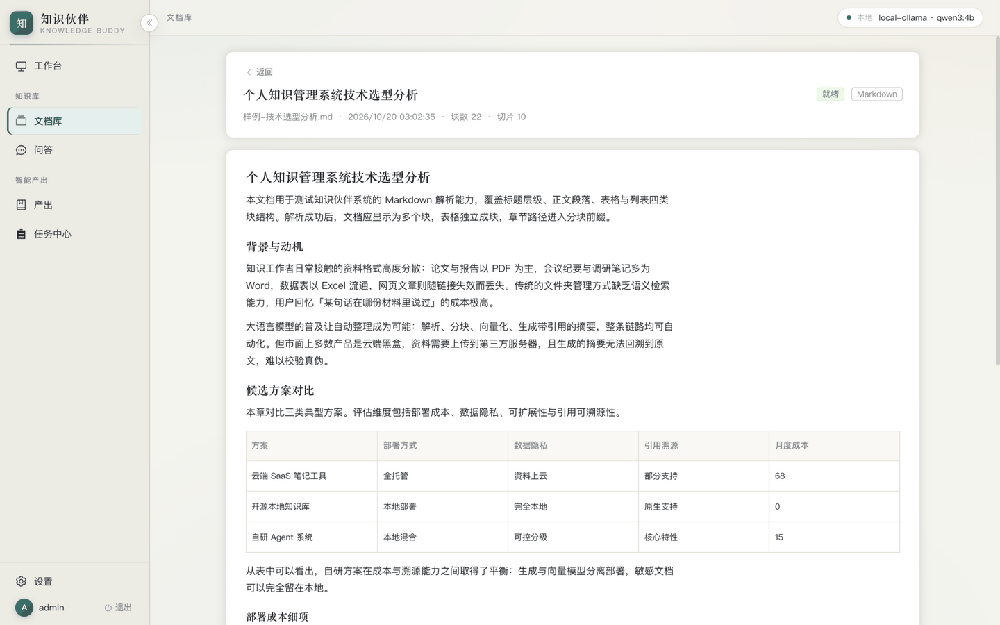 |

| 知识问答 · 流式 Markdown 回答（含表格），结论后带 `[doc_id:block_id]` 引用标记 | 引用回溯 · 点击引用标记查看来源文档与原文片段 |
|:--:|:--:|
| 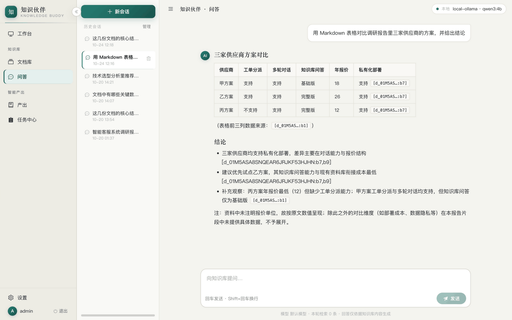 | 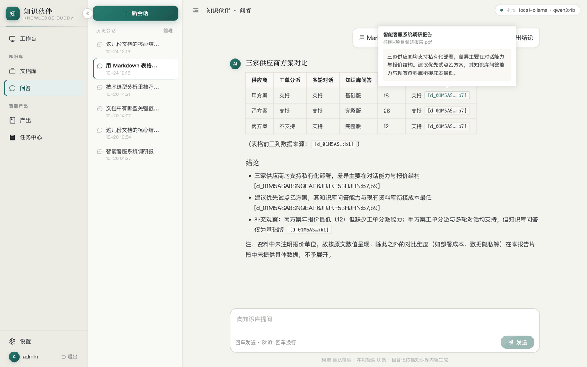 |

| 产出 · 笔记 / 报告 / 播客三类统一管理，支持标题与标签检索 | 笔记详情 · 摘要、表格、要点逐句带引用，可编辑与打标签 |
|:--:|:--:|
| 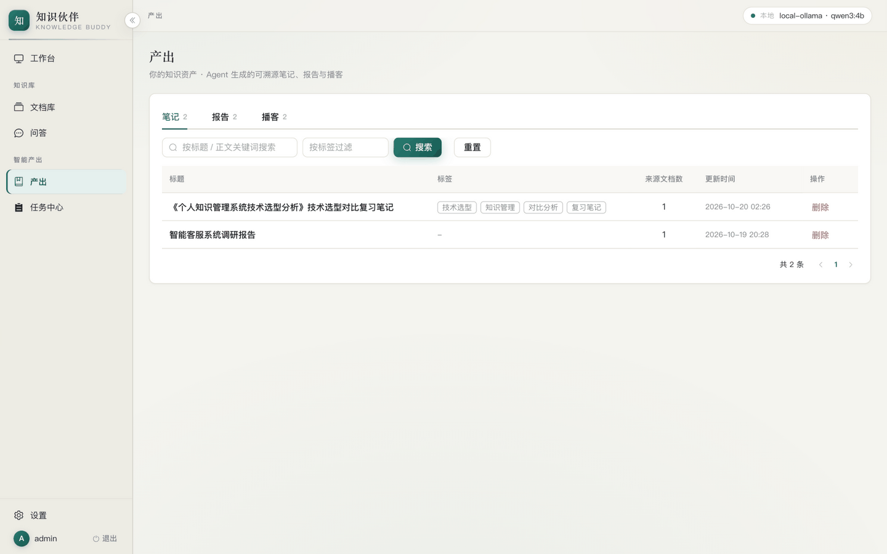 | 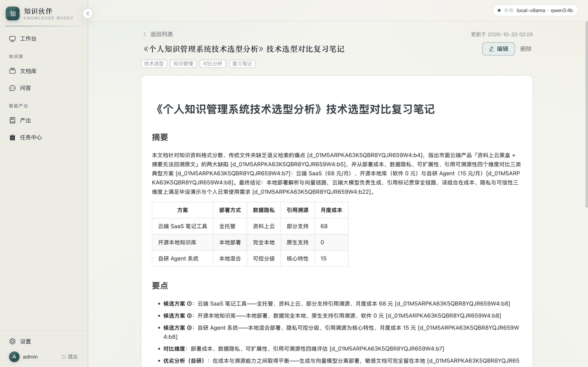 |

| 报告预览 · 自包含 HTML，左侧目录锚点 + 正文引用角标，可直接下载 | 任务中心 · 任务状态 / 类型 / 模型 / 错误一览，支持筛选 |
|:--:|:--:|
| 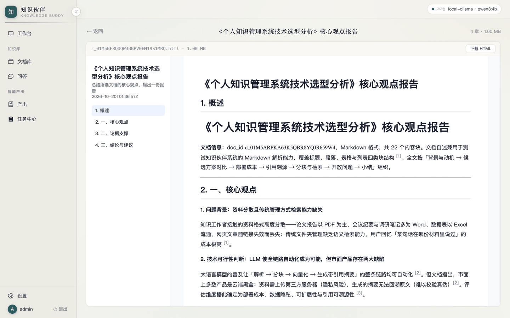 | 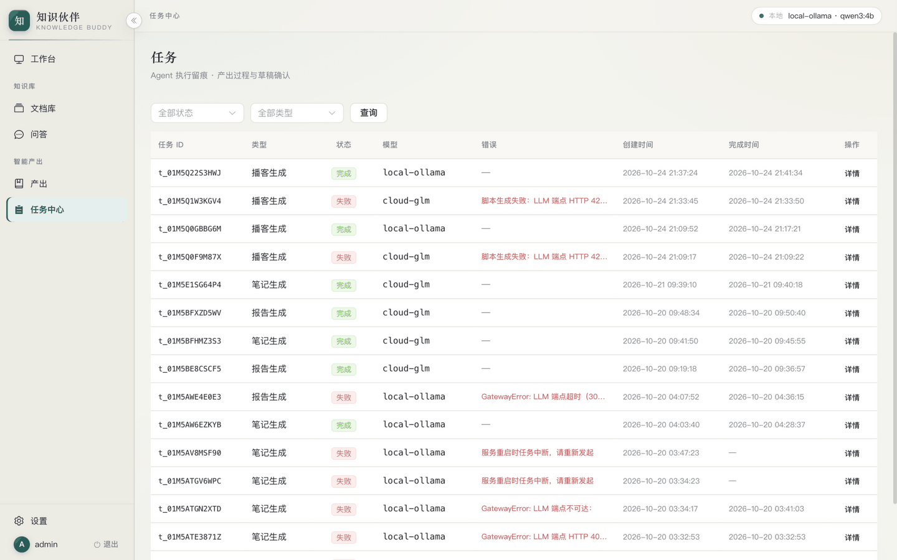 |

| 任务详情 · Agent 执行时间线（思考 → 工具调用 → 观察）逐步留痕 | 设置 · 模型供应商（云端 GLM / 本地 Ollama / LM Studio）测试与切换 |
|:--:|:--:|
| 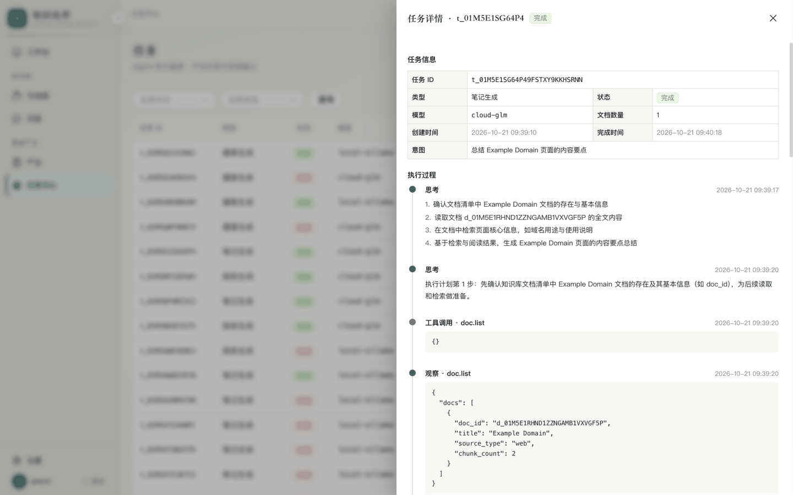 | 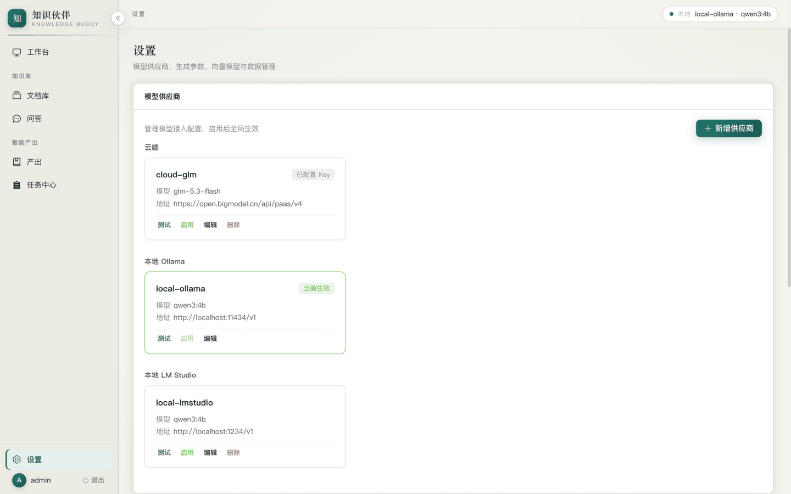 |

## 目录结构

```
backend/    FastAPI 应用（app/ 源码 + tests/ 单元与集成测试）
frontend/   Vue 3 前端（views/stores/api/composables）
data/       运行期数据（gitignore）：sqlite / chroma / storage
reports_output/  生成的自包含报告 HTML（gitignore）
docs/       需求、总体设计、实现方案、全功能开发规格、测试报告、本地部署与运行指南；screenshots/ 页面预览截图
```

## 环境要求

> 完整的环境准备、分步部署、验证与常见问题排查，见 **[docs/07-本地部署与运行指南.md](docs/07-本地部署与运行指南.md)**。下面是摘要。

- Python ≥ 3.11 且 < 3.13（后端用 [uv](https://docs.astral.sh/uv/) 管理依赖；不用 uv 可 `pip install -r backend/requirements.txt`）
- Node.js ≥ 20（前端构建）
- 本地 Ollama：`bge-m3` 向量模型**必需**（问答/检索/笔记/报告均依赖）；`qwen3:4b` 可选，作为无云端 Key 时的本地生成方案

## 快速启动

```bash
# 1. 后端
cd backend
cp .env.example .env          # 至少配置 KB_SECRET_KEY（生成命令见 .env.example 注释）
uv run uvicorn app.main:app --reload --port 8000
#    （已有 venv 时：.venv/bin/python -m uvicorn app.main:app --reload --port 8000）

# 2. 前端
cd frontend
npm install
npm run dev                   # http://localhost:5173，已代理 /api → :8000
```

默认账号 `admin / admin123`（首启自动创建，日志会提示尽快修改；改密方式见规格 §4.2）。

## 配置模型（两选一）

**方式 A：`.env`（推荐首启前配好）**

```bash
# backend/.env
KB_SECRET_KEY=<Fernet key，生成：python -c "from cryptography.fernet import Fernet;print(Fernet.generate_key().decode())">
GLM_API_KEY=<你的智谱 API Key>
```

启动后在「设置 → 模型供应商」里对 `cloud-glm` 点「测试 → 启用」。

**方式 B：设置页在线配置**

登录后进入「设置」页，编辑 `cloud-glm` 填入 API Key，测试连通后「启用」。本地 Ollama / LM Studio 供应商同理（无需 Key）。

> 未启用任何供应商时，笔记/报告/问答会返回 `PROVIDER_CONFIG` 错误——这是预期行为（规格 §5.4）。
> 向量模型固定走本地 `EMBEDDING_BASE_URL`（默认 `http://localhost:11434/v1`，模型 `bge-m3`），与生成供应商无关；首次写入向量后锁定，更换需清空文档重建。

## 真实链路冒烟

```bash
# 1. 启动 Ollama 向量服务（必需）：ollama pull bge-m3 && ollama serve
# 2. 启动后端 + 前端（见上），浏览器登录
# 3. 设置页：配置 GLM key → 测试 → 启用（CurrentModelBadge 变绿）
# 4. 工作台上传一份 PDF → 文档页等状态变「就绪」
# 5. 问答页提问 → 流式回答 + 可点引用
# 6. 生成一份对比笔记 / 报告 → 任务页看时间线 → 笔记/报告页查看产物
# 或命令行验证：
curl -s localhost:8000/api/health
TOKEN=$(curl -s -X POST localhost:8000/api/auth/login -H 'Content-Type: application/json' -d '{"username":"admin","password":"admin123"}' | python3 -c 'import sys,json;print(json.load(sys.stdin)["token"])')
curl -s -X POST localhost:8000/api/settings/providers/1/test -H "Authorization: Bearer $TOKEN"
```

## 开发与测试

```bash
cd backend
uv run pytest               # 全部测试（mock 网关，无需真实模型/网络）49 条
uv run ruff check .         # 静态检查
cd frontend
npm run build               # 生产构建
```

- 报告图表库供应商化：`bash backend/scripts/vendor_echarts.sh`（frontend 装好依赖后执行一次，产物 `backend/app/report/assets/echarts.min.js` 已入库，无 CDN 外链）
- 网页解析 Playwright 内核未预下载（体积原因）：需要抓取 JS 渲染页时执行 `uv run playwright install chromium`；trafilatura 静态抽取链路开箱可用。

## 手工走查清单（规格 §15.2 摘要，验收用）

- [ ] 正确账密登录；错误密码 401 文案统一；无 token 访问业务接口 401 跳登录页
- [ ] 新增 provider → test 通过 → activate 后顶栏角标即时更新；删除生效中 provider 409
- [ ] 单 PDF 上传 → 解析就绪块数>0；批量 5 文件全部入库；.txt 上传 415；扫描件标「低质量」
- [ ] URL 抓取正文无导航残留；删除文档后搜索无残留、笔记引用变 broken 提示
- [ ] 语义搜索 top-5 相关；doc_ids 过滤生效
- [ ] 双文档生成对比笔记：任务时间线完整（思考/工具/观察/反思四类节点）、引用可回跳、编辑后引用重建
- [ ] 问答：流式输出含可点引用；无依据问题返回固定拒答话术；会话历史可回看；SSE 中断有可见错误态
- [ ] 报告：Excel 源出图正确；HTML 断网可开、目录/引用交互可用；下载响应正确
- [ ] 任务面板 paused 任务可批准（可修订草稿）/拒绝；进行中任务可取消
- [ ] 设置页改温度保存；embedding 锁定后 409 提示；数据导出 zip 可下载

## 未完成 / 已知边界（如实声明）

- 真实模型端到端联调：后端全链路以 mock 网关测试覆盖；真实 GLM key 冒烟步骤见上（待用户填 key 后执行）
- Playwright 浏览器内核未预下载（静态抽取可用，动态渲染需补装）
- OCR 不做（仅标记 `parse_quality=low`）；多用户/密码修改接口为 P2 非目标（见规格 §0）
- docker-compose 未提供（规格列为可选交付）
